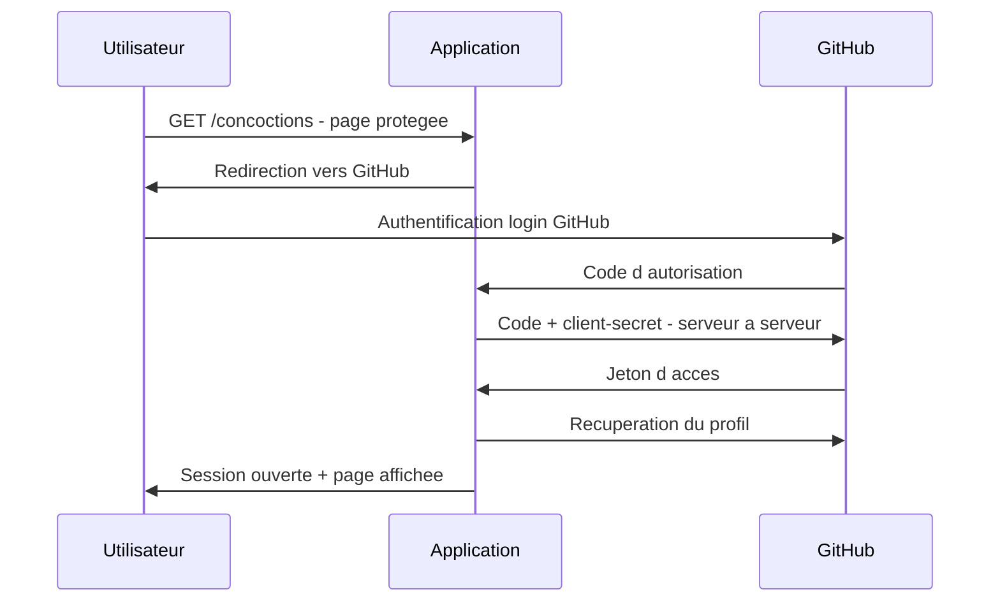

# 🏗️ Architecture & flux d'authentification

Ce document détaille l'authentification, l'autorisation, et la place de **PKCE**.

## 👥 1. Les acteurs

| Rôle (OAuth2) | Définition | Dans ce projet |
|---------------|------------|----------------|
| 🪪 **Resource Owner** | L'utilisateur, propriétaire de son identité | La personne qui se connecte |
| 💻 **Client** | L'application qui demande l'accès | L'application Spring Boot |
| 🏛️ **Authorization Server** | Authentifie l'utilisateur et émet les jetons | GitHub |

> 💡 GitHub cumule ici plusieurs rôles (Authorization Server, Resource Server via son API profil, Identity Provider de fait).

## 🔁 2. Flux OAuth2 — Authorization Code

L'application utilise le flux **Authorization Code**, adapté aux **clients confidentiels**.

### 🔑 Points clés

- 🙈 Le mot de passe n'est **jamais** vu par l'application (saisi uniquement chez GitHub)
- 🔒 Le jeton est échangé **serveur à serveur**, hors du navigateur
- 🪪 Le `client-secret` prouve l'identité de l'application auprès de GitHub

## 👑 3. Attribution des rôles

Après récupération du profil GitHub, `ApothecaireUserService` attribue :

- 👑 **MAITRE** → pseudos explicitement listés
- 👤 **APPRENTI** → tout autre utilisateur

Ce rôle est utilisé par Spring Security pour le contrôle d'accès (`hasRole("MAITRE")`).

## 🧵 4. Gestion de session

Une fois authentifié, l'utilisateur dispose d'une **session serveur** (cookie `JSESSIONID`).

🚪 La déconnexion (`POST /logout`, protégée par token CSRF) invalide la session côté serveur.

## 🧩 5. Le cas de PKCE

### ❓ Qu'est-ce que PKCE ?

**PKCE** (*Proof Key for Code Exchange*) empêche qu'un code d'autorisation intercepté soit réutilisable :

1. 🎲 Le client génère un secret aléatoire (`code_verifier`) + son empreinte hachée (`code_challenge`)
2. 📤 Il envoie le `code_challenge` lors de la demande d'autorisation
3. 📥 Lors de l'échange, il envoie le `code_verifier` en clair
4. ✅ Le serveur rehache le `code_verifier` et le compare au `code_challenge` stocké

➡️ Un attaquant qui intercepte le code **ne peut pas l'échanger** sans le `code_verifier`.

### 🚫 Pourquoi PKCE n'est pas utilisé ici

| | 🔒 Client confidentiel (ce projet) | 📱 Client public |
|---|---|---|
| Qui protège l'échange | `client-secret` | PKCE |
| Exemple | App serveur Spring Boot | App mobile, SPA |
| PKCE nécessaire | ❌ Non | ✅ Oui |

Deux raisons :

- 🖥️ L'application s'exécute **côté serveur** et garde un `client-secret`
- 🐙 **GitHub n'implémente pas PKCE** sur son OAuth2

➡️ PKCE a donc été **étudié** mais n'est **pas actif**.

## 📌 Résumé

- 🔑 OAuth2 = **authentification déléguée** → pas de mot de passe géré en local
- 🪪 Authentification (`oauth2Login`) ≠ Autorisation (`hasRole`)
- 🔒 Sécurité appliquée **côté serveur**, pas via l'affichage
- 🧩 PKCE compris, mais non requis pour un client confidentiel
